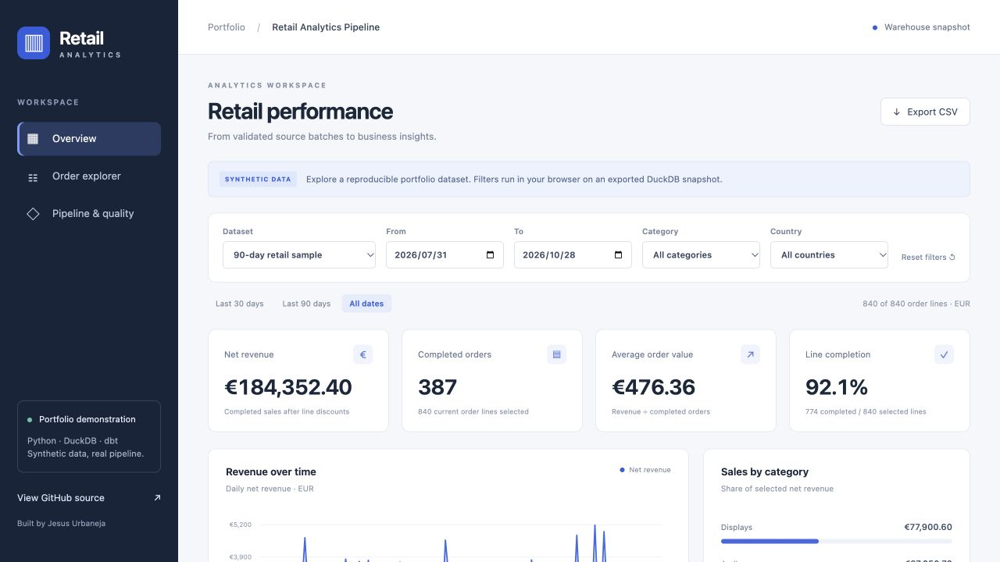
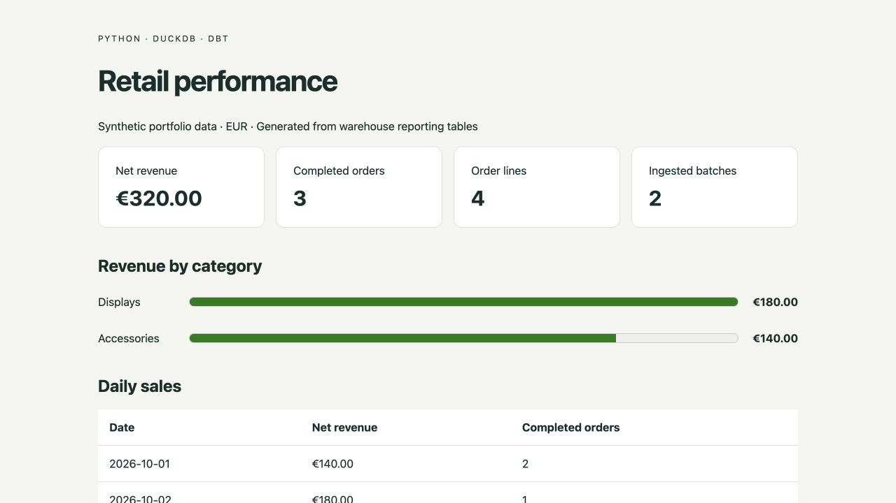
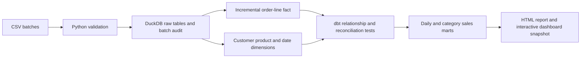

# Retail Analytics Pipeline

A small, runnable ELT project that turns synthetic retail CSV batches into a
dimensional warehouse and a standalone revenue report. Python validates and loads
the data; DuckDB stores it; dbt builds and tests the analytical models.

**[Open the public interactive dashboard](https://retail-analytics-jesus.daintyeagle131.chatgpt.site/)**

Explore date/category/country filters, revenue trends, a searchable order-line
table, CSV export and the pipeline's actual dbt quality results. Choose the
90-day synthetic retail sample or the four-line validation example. The public
dashboard filters an exported warehouse snapshot in the browser; it does not
connect to a live cloud database.



The interesting part is correctness when the source changes: duplicate deliveries,
late orders, revised discounts and cancellations must not inflate revenue.

## Run it

Python 3.11 or 3.12. Run commands from the repository root. No cloud account,
API key or paid service is needed.

```bash
python -m venv .venv
source .venv/bin/activate
pip install -r requirements.lock.txt
pip install --no-deps -e .
retail demo
```

Open `build/report.html` in a browser. The command creates two CSV batches,
loads the initial batch, runs `dbt build`, applies the update batch, runs
`dbt build` again, then exports the report. Repeating it is safe.

**Expected result:** 4 current order lines, 3 completed orders, **€320.00** net
revenue. The initial €490.00 changes by −€20.00 for a corrected discount,
−€200.00 for a cancellation and +€50.00 for a late-arriving order.



The generated HTML is also checked in at [docs/sample-report.html](docs/sample-report.html).
It is a static export of the warehouse, not a live cloud backend.

## Run the interactive dashboard locally

After the installation above:

```bash
retail demo
retail showcase
python scripts/prepare_dashboard.py
python -m http.server 8000 --directory build/dashboard
```

Open `http://localhost:8000`. The showcase uses a separate DuckDB warehouse and
840 synthetic order lines across 90 days. Both datasets are exported after a
successful dbt build, with test results and batch provenance. See the
[dashboard guide](dashboard/README.md) for export and refresh details.

## Architecture



- **Ingestion:** strict column contracts, unique source keys, valid dates,
  positive quantities/revisions, integer EUR cents, supported statuses and
  valid customer/product references. Any failed load rolls back the batch.
- **Replay safety:** a canonical content digest identifies an already-loaded
  batch. Per-line revision checks ignore stale versions and reject conflicting
  content at the same revision.
- **Incremental facts:** dbt `delete+insert` updates rows by `line_id`. A monotonic
  ingestion batch ID is the watermark, so a late order dated earlier than the
  latest business date still loads. The boundary batch is reread safely.
- **Warehouse:** one fact row per current order line, plus customer, product and
  date dimensions. Customer/product keys are deterministic MD5 surrogate keys;
  current attributes use SCD type 1. The date dimension covers observed dates.
- **Business metrics:** completed revenue is quantity × unit price − line
  discount. Cancelled lines remain auditable but contribute zero. Marts rebuild
  after fact updates so corrections propagate to prior dates/categories.
- **Quality:** dbt tests check keys, nulls, accepted statuses, relationships,
  fact/source counts and revenue reconciliation from raw data through both marts.

See [data contract](docs/data-contract.md) and [interview walkthrough](docs/walkthrough.md).

## Individual commands

```bash
retail ingest --input build/demo-data/initial
retail build
retail build --full-refresh
retail report --output build/report.html
pytest -q
ruff check .
ruff format --check .
```

Use `--database PATH` on each command for a separate warehouse. dbt uses the
repository's `dbt/profiles.yml` and the CLI passes an absolute database path.
To run dbt directly, set `RETAIL_DB_PATH` and pass `--project-dir dbt --profiles-dir dbt`.

GitHub Actions runs Python checks and the complete pipeline on Python 3.11 and
3.12, and uploads the generated report, snapshots and dashboard as artifacts.
It also runs eight dashboard aggregation/filter/export tests with Node.js 24.

## Scope and trade-offs

This is a portfolio implementation using deliberately small synthetic fixtures,
not a production deployment or a measured large-scale benchmark. It demonstrates
ELT and warehouse design without claiming Snowflake deployment experience.

There is one local writer. Ingestion and dbt builds are separate recoverable
steps: a failed build can rerun against committed raw data. dbt builds are not
one transaction across every model; consumers should use the report only after
a successful build. Dimensions accept updates in arrival order and require
source discipline; only order lines have explicit revisions. Source deletes,
refunds, multi-currency conversion, SCD type 2 history and orchestration are
outside this version. There are no customer identities or personal records.

Development used AI assistance. The source, assumptions and executable tests
are provided for review and learning.
